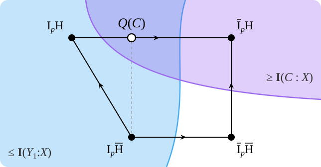

# On the most informative Boolean function under noise

Dimiter Kramer and Mert Saglam · [Paper (PDF)](courtade-kumar.pdf)

**Abstract.** Let $X$ be a uniform random bit string and let $Y$ be obtained by
flipping each bit of $X$ independently with probability $p$. Let $C$ be a
random bit obtained as a function of $Y$. We show that
$\mathbf{I}(C : X) \le \mathbf{I}(Y_1 : X)$ for every $p \in [0,1]$. This
resolves a conjecture posed by Courtade and Kumar in 2013.

 

## Concurrent work

[Ky and Tran](https://arxiv.org/abs/2609.24184) and
[Chen et al.](https://arxiv.org/abs/2609.24931) each submitted a proof of the
Courtade–Kumar conjecture to arXiv on September 21, 2026.
[Mahdavifar and Beirami](https://arxiv.org/abs/2609.26444) submitted theirs on
September 22. We obtained our result independently, without knowledge of the
other teams’ progress.

On October 6, 2026, OpenAI released two further proofs, both dated September 24.
The [first proof][hellinger] derives the conjecture from a Hellinger contraction
inequality and uses computer-assisted verification of scalar inequalities. The
[second proof][binary-contraction] proves sharp information contraction for
randomized binary outputs.

## Earlier versions

- By September 20, 2026, we had written down the induction proof.
  [View the September 20 repository snapshot.][induction]
- By September 17, 2026, we had written down a proof using Fourier analysis.
  [View the September 17 repository snapshot.][fourier]

[hellinger]: https://github.com/openai/math/blob/main/preprints/Hellinger-contraction-with-arbitrary-Boolean-output-bias-September-24-2026/main.pdf
[binary-contraction]: https://github.com/openai/math/blob/main/preprints/Sharp-binary-information-contraction-on-the-discrete-cube-September-24-2026/main.pdf
[induction]: https://github.com/deepinfra/courtade-kumar/tree/a07761c524720b09131ad5ff3a19567d50afd88b
[fourier]: https://github.com/deepinfra/courtade-kumar/tree/1b7f2448a23702eecf7855f5ba6b7b13a44fce73
